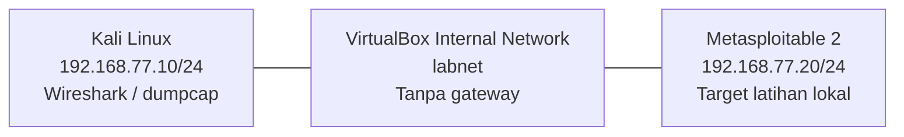

# Cybersecurity Home Lab & Packet Analysis

**Penulis:** [Boy Cristoper](https://github.com/boycristoper)

**Repository:** [cybersecurity-home-lab-portfolio](https://github.com/boycristoper/cybersecurity-home-lab-portfolio)

**Fokus:** fondasi SOC/blue team, analisis paket, dokumentasi bukti

**Status:** starter project telah dipublikasikan di GitHub; analisis referensi menggunakan data sintetis. Praktik VM dan analisis GUI pribadi masih perlu dikerjakan.

Mini project ini menggabungkan dua kegiatan yang saling mendukung:

1. Membangun lab VirtualBox dengan Kali Linux dan Metasploitable 2 pada jaringan internal terisolasi.
2. Merekam dan menganalisis ARP, ICMP, HTTP serta pola koneksi TCP menggunakan Wireshark.

Repository juga menyediakan **PCAP sintetis** untuk latihan awal tanpa VM. File ini dibuat oleh script lokal, bukan rekaman VM yang benar-benar berjalan. Angka dan frame pada laporan referensi hanya berlaku untuk dataset tersebut. Tidak ada eksploitasi, pencurian kredensial atau serangan ke jaringan publik dalam latihan ini.

## Mulai dari sini

| Tahap | Panduan / hasil |
|---|---|
| 1. Pahami dataset contoh | [Laporan referensi](reports/reference-analysis.md) dan [manifest](samples/manifest.json) |
| 2. Buka contoh di Wireshark | [Workbook analisis](docs/03-analysis-workbook.md) |
| 3. Siapkan lab sendiri | [VirtualBox + Kali + Metasploitable](docs/01-home-lab.md) |
| 4. Rekam traffic sendiri | [Panduan capture](docs/02-capture-lab.md) |
| 5. Tulis hasil pengamatanmu | [Template laporan praktik](reports/my-lab-analysis-template.md) |
| 6. Siapkan GitHub dan CV | [Publikasi dan kalimat CV](docs/04-github-and-cv.md) |

## Quick start tanpa VM

Python 3.10+ digunakan untuk script pendamping; tidak perlu paket pip. Script generator dan analyzer hanya membaca/menulis file lokal. Jalankan dari folder repo:

```powershell
python scripts/generate_reference.py
python scripts/analyze_pcap.py samples/synthetic-reference.pcap --label synthetic-reference --json reports/reference-summary.json --csv reports/reference-frames.csv
python -m unittest discover -s tests -v
```

Di Linux/Kali ganti `python` dengan `python3`. Buka `samples/synthetic-reference.pcap` memakai Wireshark, lalu kerjakan workbook. Analyzer Python hanya pendamping terbatas, tidak menggantikan decoding atau analisis Wireshark. Script probe jaringan adalah script terpisah yang hanya dipakai pada tahap lab terisolasi.

Hasil yang diharapkan: **38 frame**, ARP 2, ICMP 4, TCP 32; HTTP adalah dua pesan di dalam TCP sehingga tidak ditambahkan lagi ke total protokol. Capture menggunakan waktu skenario tetap **1 Januari 2026 UTC**, bukan tanggal pelaksanaan praktik penulis.

## Topologi lab yang direncanakan



Capture dilakukan dari Kali. Internal Network tidak memberikan akses langsung dari host Windows, LAN atau internet. Konfigurasi ini masih perlu kamu buktikan melalui screenshot dan pemeriksaan rute saat menjalankan lab.

## Pertanyaan analisis

- Bagaimana ARP menemukan alamat MAC target sebelum komunikasi IPv4?
- Di frame mana handshake TCP terjadi?
- Apa yang dapat dan tidak dapat disimpulkan dari HTTP plaintext?
- Bagaimana membedakan SYN/ACK, RST/ACK, dan tidak adanya respons?
- Mengapa beberapa koneksi ke port berbeda belum cukup membuktikan adanya penyerang?

## Struktur

```text
docs/       Panduan praktik, workbook, GitHub dan CV
samples/    PCAP sintetis yang aman dipublikasikan + asal-usul/frame manifest
scripts/    Generator offline, analyzer terbatas, probe target lab tetap
reports/    Hasil contoh terverifikasi + template hasil praktik pribadi
evidence/   Bukti nyata pribadi; file mentah diabaikan Git secara default
tests/      Pemeriksaan integritas format, checksum, parser dan kesimpulan contoh
```

## Batas klaim portofolio

- **Dikerjakan dalam penyusunan paket:** generator, dataset sintetis, analyzer dan dokumentasi contoh.
- **Belum menjadi pengalaman pribadi penulis:** konfigurasi dua VM, capture langsung, screenshot Wireshark dan analisis hasil lab sendiri.
- Setelah praktik, isi laporan baru dengan output dan bukti sebenarnya. Sesuaikan status README dan gunakan kalimat CV yang sesuai tahapmu.

Catatan pendampingan: starter project ini disusun dengan bantuan AI. Boy Cristoper perlu menjalankan, meninjau dan menjelaskan kembali analisisnya sebelum mengklaim penguasaan pada CV. Kontribusi pribadi selanjutnya dicatat pada [log belajar](LEARNING_LOG.md).

## Referensi utama

- [VirtualBox: networking modes](https://docs.oracle.com/en/virtualization/virtualbox/7.2/user/networkingdetails.html)
- [Kali: prebuilt VirtualBox image](https://www.kali.org/docs/virtualization/import-premade-virtualbox/)
- [Rapid7: Metasploitable 2](https://docs.rapid7.com/metasploit/metasploitable-2/)
- [Wireshark: display filters](https://www.wireshark.org/docs/man-pages/wireshark-filter)
- [Wireshark: dumpcap](https://www.wireshark.org/docs/man-pages/dumpcap.html)
- [Wireshark: TShark](https://www.wireshark.org/docs/man-pages/tshark.html)
- [IETF: PCAP format draft](https://datatracker.ietf.org/doc/html/draft-ietf-opsawg-pcap-09)
- [RFC 1071: Internet checksum](https://datatracker.ietf.org/doc/html/rfc1071)
