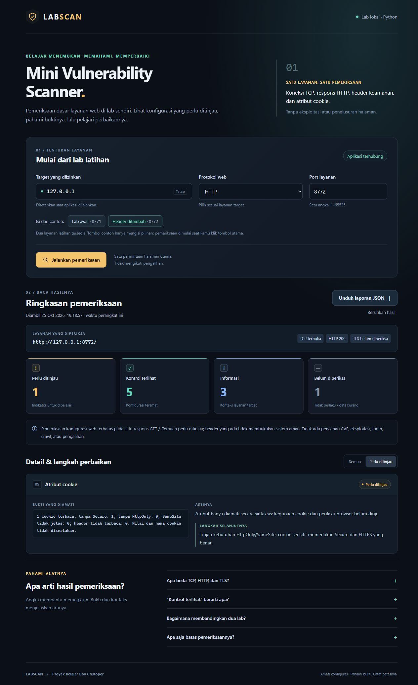

# Mini Vulnerability Scanner — LABSCAN

Aplikasi Python untuk memeriksa konfigurasi dasar **satu layanan web di lab sendiri**, lalu menampilkan bukti, penjelasan, dan saran perbaikan dalam dashboard lokal.

Proyek belajar [Boy Cristoper](https://github.com/boycristoper). Python 3.10+ dan standard library; tanpa paket pip, API key, atau layanan analisis eksternal.



*Pratinjau pengujian pengembangan di Windows menggunakan layanan demo loopback. Ini bukan bukti praktik Boy di Kali atau temuan pada sistem produksi.*

## Fungsi

- Memeriksa konektivitas satu port TCP dan respons HTTP.
- Memverifikasi koneksi HTTPS memakai pemeriksaan sertifikat bawaan Python.
- Mengamati CSP, pengaturan frame, nosniff, Referrer-Policy, serta konteks HSTS.
- Merangkum atribut cookie tanpa menampilkan nama atau nilainya.
- Menjelaskan bukti, arti hasil, dan saran untuk setiap pemeriksaan.
- Membandingkan dua layanan demo dan mengekspor laporan JSON.

Port terbuka sendiri bukan celah. Header yang terlihat belum membuktikan kebijakannya efektif. Jumlah indikator bukan jumlah kerentanan terkonfirmasi.

## Mulai cepat

Jalankan di Terminal Linux/Kali:

```bash
git clone https://github.com/boycristoper/cybersecurity-home-lab-portfolio.git
cd cybersecurity-home-lab-portfolio
python3 -m unittest discover -s tests -v
python3 app.py --with-demo
```

Di Windows, gunakan `python` jika perintah `python3` tidak tersedia. Tes yang berhasil berakhir dengan `OK`.

Buka **http://127.0.0.1:8770** di browser pada mesin yang menjalankan Python. Biarkan terminal server terbuka; tekan `Ctrl+C` untuk berhenti.

1. Pilih **Lab awal · 8771**, lalu klik **Jalankan pemeriksaan**.
2. Baca bukti, arti, dan saran. Unduh laporan JSON.
3. Pilih **Header ditambah · 8772**, lalu periksa dan bandingkan.

## Membaca hasil

| Kategori | Makna |
|---|---|
| Perlu ditinjau | Indikator konfigurasi yang memerlukan pemeriksaan konteks |
| Kontrol terlihat | Konfigurasi atau atribut yang dicari teramati |
| Informasi | Fakta pendukung tentang layanan |
| Belum diperiksa | Bukti belum tersedia atau pemeriksaan tidak berlaku |

Dalam uji pengembangan, profil awal memiliki **5 indikator perlu ditinjau**, sedangkan profil pembanding **1**. Kedua layanan tetap memakai HTTP; cookie pembanding masih belum memiliki `Secure`. Hasil tersebut menunjukkan perbedaan konfigurasi, bukan jaminan keamanan.

## Dokumentasi

- [Panduan praktik dan arti istilah](PANDUAN.md)
- [Hasil pengujian pengembangan](TESTING.md)
- [Template laporan praktik pribadi](LAPORAN-TEMPLATE.md)
- [Contoh laporan dan asal datanya](examples/README.md)

| Berkas | Peran |
|---|---|
| `scanner.py` | Koneksi terbatas dan aturan interpretasi hasil |
| `app.py` | Dashboard lokal dan API |
| `demo_lab.py` | Dua layanan HTTP latihan |
| `static/` | Tampilan dan interaksi browser |
| `tests/` | Pengujian aturan, jaringan sintetis, dan HTTP lokal |

## Lingkup

Target bawaan adalah `127.0.0.1`. Satu pemeriksaan meminta `GET /` dari satu layanan; redirect tidak diikuti. Target dapat ditetapkan saat startup sebagai satu IPv4 literal loopback/RFC1918 milik sendiri atau berizin. Tidak ada penemuan jaringan, audit seluruh sistem operasi, login, payload eksploit, atau pencocokan CVE.

Laporan tidak memuat isi halaman atau nilai cookie, tetapi tetap menyebut alamat dan konteks layanan. Periksa hasil sebelum membagikannya. Pengamatan HSTS pada IP literal hanya menyangkut sintaks header; browser menerapkan HSTS pada hostname.

## Status dan kontribusi

Kode awal, tes, dan dokumentasi disiapkan dengan bantuan AI. **22 tes lulus pada Windows/Python 3.12.10**; rincian dan batasnya tersedia di [TESTING.md](TESTING.md). Hasil praktik Boy di Kali belum dicatat. Template laporan disediakan untuk pengamatan dan penjelasan pribadi setelah praktik.

## Rujukan

- [OWASP HTTP Headers Cheat Sheet](https://cheatsheetseries.owasp.org/cheatsheets/HTTP_Headers_Cheat_Sheet.html)
- [OWASP Session Management Cheat Sheet](https://cheatsheetseries.owasp.org/cheatsheets/Session_Management_Cheat_Sheet.html)
- [RFC 6797: HSTS](https://www.rfc-editor.org/rfc/rfc6797.html#section-8.1)
