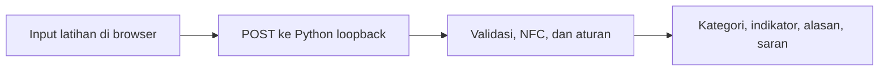

# Panduan lengkap — Password Strength Checker

## Tujuan

Mini project ini membantu Boy memahami mengapa suatu password latihan memiliki kelemahan yang mudah dikenali. Hasilnya disertai alasan dan saran, sehingga tidak hanya berupa angka atau warna. Keterampilan yang dilatih: logika kondisi Python, pemrosesan string Unicode, validasi input, alur browser/API lokal, pengujian, dan dokumentasi.

Kode awal dan tes dibuat dengan bantuan AI. Boy belum menjalankan proyek ini di Kali pada saat paket disusun. Catat hanya praktik yang benar-benar dilakukan.

## 1. Buka proyek di Kali

Folder bersama `sf_KaliTransfer` yang sudah dipakai proyek sebelumnya juga menyediakan ZIP baru. ZIP masih tersimpan di Windows; perintah ekstraksi membuat salinan isi proyek pada disk Kali.

Jalankan di terminal Kali:

```bash
mkdir -p ~/projects
python3 -m zipfile -e /media/sf_KaliTransfer/password-strength-checker-portfolio.zip ~/projects
cd ~/projects/password-strength-checker
python3 -m unittest discover -s tests -v
```

| Perintah | Fungsi |
|---|---|
| mkdir -p | Membuat folder projects jika belum ada |
| python3 -m zipfile -e | Memakai modul bawaan Python untuk mengekstrak ZIP |
| cd | Masuk ke folder program |
| unittest discover -s tests -v | Menjalankan semua tes pada folder tests dan menampilkan tiap hasil |

Setelah tes berakhir OK, jalankan:

```bash
python3 app.py
```

Buka `http://127.0.0.1:8766` pada browser Kali. `127.0.0.1` berarti mesin tempat browser berada; 8766 adalah port aplikasi. Dashboard jaringan yang memakai 8765 boleh tetap berjalan. Terminal app.py perlu tetap terbuka selama dipakai.

## 2. Coba seluruh alur memakai contoh publik

Gunakan tombol contoh pada halaman. Setelah contoh mengisi kolom, klik tombol pemeriksaan untuk mengirimkannya ke proses lokal.

| Contoh dummy publik | Hasil yang diharapkan dari aturan ini | Yang dipelajari |
|---|---|---|
| 123456 | Perlu diperbaiki | Pendek dan cocok contoh umum/urutan |
| abcabcabcabcabcabc | Perlu diperbaiki | Panjang saja tidak menghilangkan pola pengulangan |
| Password123456789! | Perlu ditinjau | Campuran karakter tetap dapat memiliki urutan mudah ditebak |
| kabut sepeda lentera sungai | Lolos pemeriksaan terbatas | Frasa/spasi diperbolehkan dan tidak harus memiliki huruf besar/angka/simbol |

Tabel ini adalah ekspektasi untuk contoh, bukan laporan hasil Boy. Semua contoh terlihat di kode dan bersifat publik; jangan gunakan sebagai password akun.

Uji juga input kosong, spasi saja, dan teks lebih dari batas 256 code point. Program seharusnya menjelaskan penolakan tanpa memotong input diam-diam. Untuk Unicode, panjang dihitung setelah normalisasi NFC; satu karakter yang tampak di layar dapat terdiri dari beberapa code point.

## 3. Arti bagian tampilan

| Bagian | Keterangan |
|---|---|
| Kolom password | Input latihan, disembunyikan pada awalnya |
| Tampil/sembunyikan | Mengubah visibilitas karakter di layar saja |
| Tombol periksa | Meminta hasil evaluasi dari Python lokal |
| Contoh dummy | Mengisi input untuk percobaan yang dapat diulang |
| Hapus | Mengosongkan input, pesan, dan hasil pada halaman |
| Unduh ringkasan tanpa password | Menyimpan JSON berisi kategori, panjang, indikator, dan saran; input tidak dimasukkan |
| Panjang | Jumlah code point setelah normalisasi NFC, bukan ukuran file atau skor |
| Indikator panjang | Membandingkan panjang dengan profil latihan minimum 15 |
| Indikator daftar contoh | Memeriksa kecocokan seluruh input dengan daftar kecil lokal |
| Indikator pengulangan | Memeriksa pola pengulangan sederhana yang dikenali kode |
| Indikator urutan | Memeriksa urutan angka/huruf/keyboard yang dikenali kode |
| Alasan | Menjelaskan indikator yang memengaruhi kategori |
| Saran | Langkah perbaikan umum, tanpa menampilkan kembali input |

Kategori Perlu diperbaiki berarti ada indikator kelemahan utama. Perlu ditinjau berarti aturan menandai pola meskipun panjang mencukupi. Lolos pemeriksaan terbatas berarti tidak ada indikator yang dikenali oleh aturan saat ini; daftar dan aturan belum lengkap.

Tidak ada kewajiban menambahkan simbol atau huruf besar agar hasil naik. Penambahan tanda seru pada password yang mudah ditebak bukan bukti otomatis menjadi kuat.

## 4. Bagaimana program memeriksa input



Python mengecek tipe dan batas input, lalu menormalkan Unicode NFC. Spasi tidak dihapus dari input dan pemeriksaan blocklist memakai kecocokan penuh setelah normalisasi/casefold. Casefold membuat pencocokan daftar tidak dibedakan oleh variasi besar-kecil huruf. Pemeriksaan pola terpisah dari blocklist dan hanya mengenali pola yang diprogram.

Pilihan minimum 15 digunakan untuk profil latihan password sebagai satu-satunya faktor, terinspirasi pedoman NIST. Ini bukan angka universal yang memastikan password kuat dan bukan bukti aplikasi mengikuti seluruh persyaratan NIST. Skenario dengan MFA memiliki persyaratan panjang yang berbeda.

## 5. Privasi dan batas

Input dikirim dari browser ke server Python lokal di Kali, bukan ke layanan internet. Input diproses di memori, tidak disimpan ke file/database, tidak dicatat di log, dan tidak dikembalikan dalam respons. Hasil berisi panjang, kategori, dan penjelasan tetap. Aplikasi tidak menyimpan riwayat input pada localStorage/sessionStorage.

Aplikasi ini tidak memeriksa password bocor secara online, tidak mencoba login, tidak membobol akun, tidak menghasilkan perkiraan waktu pembobolan, dan tidak menyimpan password untuk autentikasi. Pemeriksaan ini juga tidak membuktikan suatu password belum pernah dipakai ulang atau tidak berkaitan dengan informasi pribadi. Pola yang terdeteksi dapat menghasilkan false positive; pola yang tidak terdeteksi dapat menghasilkan false negative.

Gunakan hanya password dummy. Menyembunyikan karakter di layar bukan jaminan kerahasiaan komputer, dan tombol Hapus hanya mengosongkan tampilan aplikasi.

## 6. Mode terminal opsional

```bash
python3 app.py --cli
```

Program meminta input lewat getpass. Ketik contoh dummy lalu Enter; karakter biasanya tidak terlihat dan itu normal. Tidak perlu menaruh input setelah nama perintah, agar tidak masuk riwayat shell. Jika terminal tidak mendukung input tersembunyi, program menolak melanjutkan. Hasil memakai aturan yang sama dengan dashboard.

## 7. Dokumentasikan praktik

Isi [LAPORAN-TEMPLATE.md](LAPORAN-TEMPLATE.md) dengan tanggal, lingkungan, hasil tes, serta hasil tiap contoh dummy. Simpan screenshot kategori/alasan dan hasil tes. Untuk media sosial, pilih contoh publik, biarkan kolom tetap tersembunyi, dan ambil gambar yang fokus pada aplikasi tanpa chat/tab pribadi.

File program berada di `~/projects/password-strength-checker`. Tekan Ctrl+C pada terminal server untuk berhenti; file kode dan laporan tetap ada. Untuk membuka lain waktu, masuk ke folder tersebut dan jalankan python3 app.py lagi.

## 8. Draf caption — setelah praktik dilakukan

> Melanjutkan belajar cybersecurity melalui mini project Password Strength Checker di Kali Linux. Saya menguji pemeriksaan panjang, contoh password umum, pola pengulangan, dan urutan sederhana. Hasil menampilkan alasan serta saran, bukan sekadar warna. Kode awal dan tes disiapkan dengan bantuan AI; saya menjalankan lab dan mempelajari cara kerjanya. Pemeriksaan terbatas ini berjalan lokal dan tidak mengecek database kebocoran.

Tambahkan angka jumlah tes atau hasil percobaan hanya setelah benar-benar dijalankan. Jangan menyebut contoh publik sebagai rekomendasi password akun.

## 9. Draf CV — sesuaikan setelah praktik

> Proyek pribadi: menguji pemeriksa password edukatif berbasis Python di Kali Linux, memvalidasi pemeriksaan panjang dan pola pada contoh dummy, serta mendokumentasikan alasan hasil dan batas penilaiannya.

Tambahkan pengembangan kode hanya jika Boy benar-benar mengubah dan dapat menjelaskan bagian tersebut. Tautan repo digunakan setelah versi proyek ini telah tersedia di GitHub.

## Rujukan

- [NIST SP 800-63B-4, Passwords](https://pages.nist.gov/800-63-4/sp800-63b.html#passwords)
- [OWASP Authentication Cheat Sheet](https://cheatsheetseries.owasp.org/cheatsheets/Authentication_Cheat_Sheet.html#implement-proper-password-strength-controls)
- [Python getpass](https://docs.python.org/3.13/library/getpass.html)
